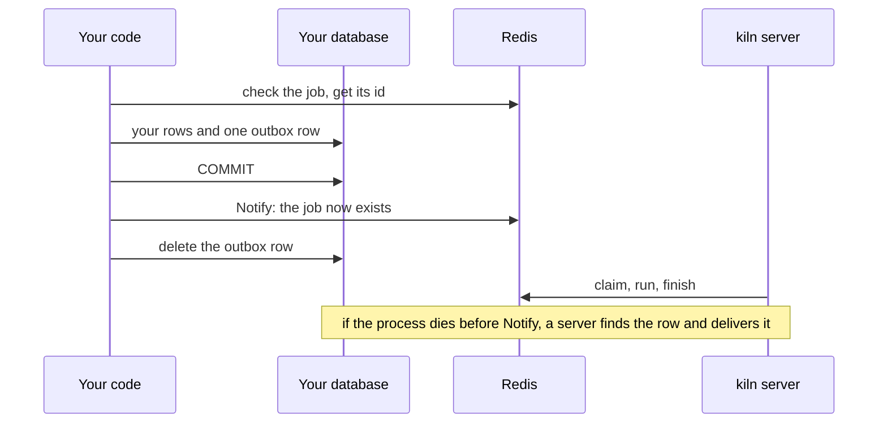

# Where jobs live

kiln can keep its jobs in your database, in Redis, or split the work between the two. The code that
enqueues and handles jobs is the same in all three. What changes is the line that builds the store.

| | In your database | In Redis | Both, through an outbox |
|---|---|---|---|
| Store | `pgstore`, `mysqlstore`, `mssqlstore`, `sqlitestore` | `redisstore` | `redisstore` with `pgstore.NewOutbox` or `mysqlstore.NewOutbox` |
| Enqueue inside your transaction | yes | no | yes |
| What your database does for a job | everything: insert, claim, finish, history, pruning | nothing | one insert in your transaction, one delete after it |
| Extra infrastructure | none | Redis 7 or later | Redis 7 or later |
| A job survives | what your database survives | what Redis is set up to survive | your database until the handoff, Redis after it |

## Which one

**Start in your database.** It is one system to run, a job commits or rolls back with the rows it belongs
to, and nothing acknowledged is lost. Most applications never need more.

**Move to Redis** when the queue's writes compete with the application's own on the database, and the
jobs are ones you can afford to run again or lose a second of: notifications, cache warming, fan-out.

**Use both** when the database feels the queue but a job must exist exactly when its order, payment or
signup committed. The database keeps that one promise and Redis does the rest.

Nothing stops you from running two: a client on the database for the jobs that need its transaction and
a client on Redis for the volume, each with its own server and the same handlers.

## Jobs in Redis

```go
rdb := redis.NewClient(&redis.Options{Addr: "localhost:6379", ContextTimeoutEnabled: true})
store, err := redisstore.New(ctx, rdb)
client := kiln.NewClient(store)
```

`redisstore` passes the same conformance suite as the SQL stores, so retries, continuations, batches,
unique jobs, limits, recurring jobs and the dashboard work as they do there. Three things are different.

**Durability is Redis's.** With the append-only file fsynced every second, a crash of Redis can lose the
last second: jobs just enqueued disappear and jobs just finished run again. With `appendfsync always`
nothing acknowledged is lost, for a disk write per call. Without persistence a restart loses every job.

**Memory is the limit.** Finished jobs stay in memory until they are pruned, so
[`Retention`](operating.md) is what sizes the server. `New` refuses a server whose `maxmemory-policy`
evicts any key, because eviction would delete jobs without telling anyone. Use `noeviction`.

**A call runs alone.** The store's code is loaded into Redis as a function library and every operation
is one call of it. Redis runs a call from start to finish with nothing in between, so there are no row
locks and no deadlocks, and nothing else runs meanwhile either. Claims, finishes and maintenance are
bounded; an insert of 10,000 jobs in one call holds the server for as long as 10,000 jobs take.

All keys of a store share one hash tag (`{kiln}:` unless `redisstore.Prefix` names another), so a store
fits in one slot of a Redis Cluster. It works on Valkey too.

## Both: an outbox

```go
store, err := redisstore.New(ctx, rdb)
ob, err := pgstore.NewOutbox(ctx, pool, store)
client := kiln.NewClient(store)
server, err := kiln.NewServer(client, mux, kiln.ServerConfig{Outbox: ob})

tx, err := pool.Begin(ctx)
// your writes
w := ob.Tx(tx)
_, err = client.EnqueueTx(ctx, w, SendEmail{To: "a@b.c"})
err = tx.Commit(ctx)
w.Notify(ctx)
```

Coming from a database store, `ob.Tx(tx)` takes the place of `store.Tx(tx)` and the rest of the code
stays as it is. `mysqlstore.NewOutbox` is the same for MySQL, and `ob.SQLTx` takes a `*sql.Tx` on
PostgreSQL.



What you can count on:

- **Commit means the job reaches Redis**, through `Notify` or, if the process stopped first, through a
  server within a couple of seconds. **Rollback means it never does.** Calling `Notify` after a rollback is
  harmless.
- **Delivering twice does nothing.** Redis remembers what it applied for seven days.
- **Unique jobs are decided on arrival.** The key is compared when the job is enqueued and again when it
  reaches Redis. If another job took the key in between, yours is the duplicate.
- **Nothing is dropped quietly.** Jobs that can no longer be created, because the parent they wait for
  was pruned or the batch they join has closed, move to the `outbox_failed` table with the reason.

What it costs:

- **Enqueueing talks to Redis inside your transaction**, one call, to check the job and give it an id.
  With Redis down, the enqueue returns an error. The transaction gives you atomicity, not a queue that
  takes jobs while Redis is away.
- **A job is in Redis only after `Notify`.** A continuation enqueued in a later transaction finds its
  parent there, as long as the first transaction was notified or a couple of seconds have passed.
- After the handoff a job is as durable as Redis is.

## What the database is spared

10,000 orders placed by 8 goroutines. Each transaction inserts the order and enqueues one job, and a
server runs the jobs. PostgreSQL 17. The numbers are per job, on top of what the order itself costs.

| | WAL written | Commits | Rows written |
|---|---|---|---|
| Jobs in PostgreSQL | 1,326 bytes | 2.4 | 4.2 |
| Jobs in Redis, outbox in PostgreSQL | 387 bytes | 1, not waited for | 2 |
| Jobs in Redis, enqueued directly | 0 | 0 | 0 |

The outbox writes 71% less to the log, and its one commit, the delete, does not wait for the disk: if a
crash loses it, the row is delivered again and Redis ignores it. The database store also keeps finished
jobs for a day and prunes them later, and its servers poll; neither is counted here.

```
cd bench && go run . -load
```
