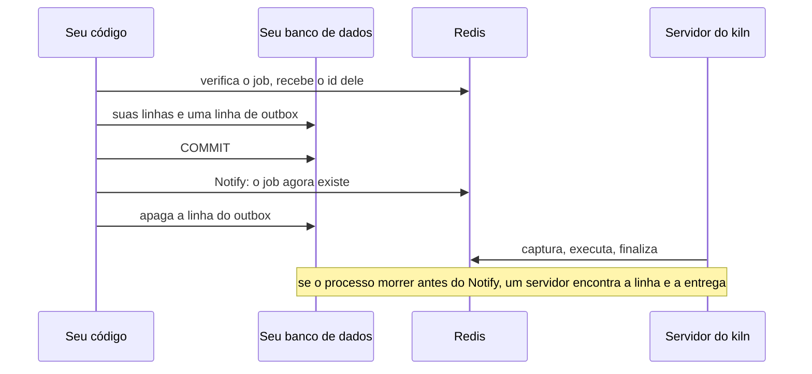

# Onde os jobs moram

O kiln pode guardar seus jobs no seu banco de dados, no Redis, ou dividir o trabalho entre os dois. O
código que enfileira e processa os jobs é o mesmo nos três casos. O que muda é a linha que constrói o store.

| | No seu banco de dados | No Redis | Os dois, através de um outbox |
|---|---|---|---|
| Store | `pgstore`, `mysqlstore`, `mssqlstore`, `sqlitestore` | `redisstore` | `redisstore` com `pgstore.NewOutbox` ou `mysqlstore.NewOutbox` |
| Enfileirar dentro da sua transação | sim | não | sim |
| O que o seu banco de dados faz por um job | tudo: insert, captura, finalização, histórico, limpeza | nada | um insert na sua transação, um delete depois dela |
| Infraestrutura extra | nenhuma | Redis 7 ou superior | Redis 7 ou superior |
| Um job sobrevive a | o que o seu banco de dados sobrevive | o que o Redis estiver configurado para sobreviver | o seu banco de dados até a entrega, o Redis depois dela |

## Qual escolher

**Comece no seu banco de dados.** É um sistema só para operar, um job sofre commit ou rollback junto com
as linhas a que pertence, e nada que foi confirmado se perde. A maioria das aplicações nunca precisa de mais.

**Passe para o Redis** quando as escritas da fila competem com as da própria aplicação no banco de dados, e
os jobs são do tipo que você pode se dar ao luxo de rodar de novo ou perder um segundo deles: notificações,
aquecimento de cache, fan-out.

**Use os dois** quando o banco de dados sente a fila, mas um job precisa existir exatamente quando o
pedido, o pagamento ou o cadastro sofreu commit. O banco de dados mantém essa única promessa e o Redis faz
o resto.

Nada impede você de rodar dois: um client no banco de dados para os jobs que precisam da transação dele e
um client no Redis para o volume, cada um com seu próprio servidor e os mesmos handlers.

## Jobs no Redis

```go
rdb := redis.NewClient(&redis.Options{Addr: "localhost:6379", ContextTimeoutEnabled: true})
store, err := redisstore.New(ctx, rdb)
client := kiln.NewClient(store)
```

O `redisstore` passa pela mesma suíte de conformidade dos stores SQL, então retentativas, continuações,
lotes, jobs únicos, limites, jobs recorrentes e o dashboard funcionam como lá. Três coisas são diferentes.

**A durabilidade é a do Redis.** Com o append-only file sofrendo fsync a cada segundo, uma queda do Redis
pode perder o último segundo: jobs recém-enfileirados desaparecem e jobs recém-finalizados rodam de novo.
Com `appendfsync always` nada que foi confirmado se perde, ao custo de uma escrita em disco por chamada.
Sem persistência, uma reinicialização perde todos os jobs.

**A memória é o limite.** Jobs finalizados ficam na memória até serem limpos, então a
[`Retention`](operating.md) é o que dimensiona o servidor. O `New` recusa um servidor cuja
`maxmemory-policy` remove qualquer chave, porque a remoção apagaria jobs sem avisar ninguém. Use
`noeviction`.

**Uma chamada roda sozinha.** O código do store é carregado no Redis como uma biblioteca de funções e toda
operação é uma chamada dela. O Redis roda uma chamada do começo ao fim sem nada no meio, então não há locks
de linha nem deadlocks, e nada mais roda enquanto isso também. Capturas, finalizações e manutenção são
limitadas; um insert de 10.000 jobs em uma chamada prende o servidor pelo tempo que 10.000 jobs levarem.

Todas as chaves de um store compartilham uma hash tag (`{kiln}:`, a menos que `redisstore.Prefix` indique
outra), então um store cabe em um slot de um Redis Cluster. Também funciona no Valkey.

## Os dois: um outbox

```go
store, err := redisstore.New(ctx, rdb)
ob, err := pgstore.NewOutbox(ctx, pool, store)
client := kiln.NewClient(store)
server, err := kiln.NewServer(client, mux, kiln.ServerConfig{Outbox: ob})

tx, err := pool.Begin(ctx)
// your writes
w := ob.Tx(tx)
_, err = client.EnqueueTx(ctx, w, SendEmail{To: "a@b.c"})
err = tx.Commit(ctx)
w.Notify(ctx)
```

Vindo de um store de banco de dados, `ob.Tx(tx)` toma o lugar de `store.Tx(tx)` e o resto do código
continua como está. `mysqlstore.NewOutbox` é igual para o MySQL, e `ob.SQLTx` recebe um `*sql.Tx` no
PostgreSQL.



Com o que você pode contar:

- **Commit significa que o job chega ao Redis**, através do `Notify` ou, se o processo parou antes,
  através de um servidor em poucos segundos. **Rollback significa que ele nunca chega.** Chamar `Notify`
  depois de um rollback é inofensivo.
- **Entregar duas vezes não faz nada.** O Redis lembra o que aplicou por sete dias.
- **Jobs únicos são decididos na chegada.** A chave é comparada quando o job é enfileirado e de novo
  quando ele chega ao Redis. Se outro job pegou a chave nesse meio tempo, o seu é o duplicado.
- **Nada é descartado em silêncio.** Jobs que não podem mais ser criados, porque o pai que eles esperam
  foi limpo ou o lote em que entrariam foi fechado, vão para a tabela `outbox_failed` com o motivo.

O que isso custa:

- **Enfileirar fala com o Redis dentro da sua transação**, uma chamada, para verificar o job e dar um id a
  ele. Com o Redis fora do ar, o enfileiramento retorna um erro. A transação dá atomicidade, não uma fila
  que aceita jobs enquanto o Redis está ausente.
- **Um job só está no Redis depois do `Notify`.** Uma continuação enfileirada em uma transação posterior
  encontra o pai lá, desde que a primeira transação tenha sido notificada ou alguns segundos tenham passado.
- Depois da entrega, um job é tão durável quanto o Redis.

## O que o banco de dados economiza

10.000 pedidos feitos por 8 goroutines. Cada transação insere o pedido e enfileira um job, e um servidor
roda os jobs. PostgreSQL 17. Os números são por job, além do que o próprio pedido custa.

| | WAL escrito | Commits | Linhas escritas |
|---|---|---|---|
| Jobs no PostgreSQL | 1.326 bytes | 2,4 | 4,2 |
| Jobs no Redis, outbox no PostgreSQL | 387 bytes | 1, sem esperar | 2 |
| Jobs no Redis, enfileirados direto | 0 | 0 | 0 |

O outbox escreve 71% menos no log, e o seu único commit, o delete, não espera o disco: se uma queda o
perder, a linha é entregue de novo e o Redis a ignora. O store de banco de dados também guarda os jobs
finalizados por um dia e os limpa depois, e os servidores dele fazem poll; nenhum dos dois está contado aqui.

```
cd bench && go run . -load
```
